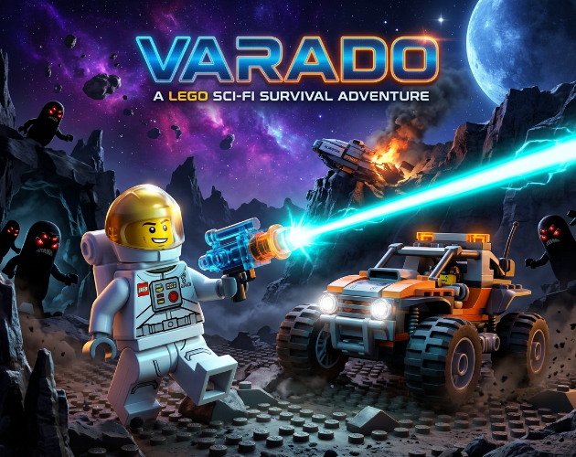

# VARADO: A LEGO Sci-Fi Survival Adventure 🚀🪐

> **Un astronauta solitario, un planeta hostil y una horda de criaturas parasitarias que no descansarán hasta cazarte.**

**VARADO** es un videojuego de acción, supervivencia y disparos en tercera persona (3D) para navegadores web (HTML5), que combina la estética nostálgica y detallada de figuras y bloques de construcción estilo LEGO® con la adrenalina y tensión del horror y la supervivencia espacial.

---

## 📖 Sinopsis

Tras una catastrófica colisión orbital, tu nave de exploración queda completamente destruida en la superficie de un mundo desconocido. Atrapado sin comunicación con el comando espacial, deberás equiparte con lo que quede en las ruinas de tu base, enfrentarte a misteriosas formas de vida alienígenas, dominar la conducción de un buggy todoterreno y buscar los componentes y piedras de ignición necesarios para activar el cohete de escape antes de que la infestación devore lo poco que queda.

---

## ✨ ¿Qué lo hace especial?

* **Contraste estético único**: Fusión visual entre el carisma plástico de las minifiguras y bloques LEGO® y la atmósfera densa y oscura de una pesadilla alienígena espacial.
* **Transición fluida a pie y en vehículo**: Conduce un buggy todoterreno modular con físicas reactivas, embiste y arrolla enemigos, o salta del vehículo en pleno movimiento para entablar combate a pie.
* **Animaciones y posturas auténticas de minifigura**: Sistema dinámico de posturas donde el personaje maneja armas a una mano (pistola) o dos manos (rifles/escopeta) respetando la proporción anatómica de las articulaciones de juguete y rotación suave tipo brújula.
* **Cero descargas y acceso instantáneo**: Desarrollado íntegramente sobre tecnologías web modernas para ejecutarse directo en el navegador a 60 FPS estables sin tiempos de carga molestos ni dependencias de instalación.

---

## 🎮 Modos de juego y dificultad

El juego cuenta con una campaña continua dividida en dos planetas con entornos, puzzles y jefes propios:
1. **Planeta Varado**: Base inicial, pasillo de combate contra el impostor, garage vehicular, mundo abierto desértico, campamentos alienígenas y el temible **Jefe Impostor**.
2. **Planeta Bershna**: Un planeta rocoso hostil donde recolectarás 8 piedras de ignición, escalarás una torre de control espiral y enfrentarás al colosal **Coloso de Roca**.

### Selector de dificultad equilibrado:
* 🟢 **Fácil**: *"Una travesía tranquila para explorar el planeta y dominar los controles sin agobios."* (Enemigos un 20% más lentos, daño recibido reducido un 20%, ataques cuerpo a cuerpo telegrafiados con 0.5s de preparación visual, hordas espaciadas y mayor tasa de munición/salud).
* 🟡 **Moderado**: *"El desafío original: supervivencia táctica, reflejos y adrenalina en equilibrio."*
* 🔴 **Difícil**: *"Peligro constante. Recursos escasos y enemigos hostiles que no perdonan errores."*
* 🟣 **INFESTACIÓN**: *"Mucha suerte."* (Aparición masiva de enemigos agresivos y rápidos, drops mínimos y letalidad máxima).

---

## ⚙️ Mecánicas de juego

* **Arsenal diverso y especializado**:
  * 🔫 **Pistola láser**: Munición infinita, disparo rápido y gran confiabilidad para enemigos ligeros.
  * 💥 **Rifle de asalto**: Ráfagas automáticas continuas de energía cian a media y larga distancia.
  * 🛑 **Escopeta**: Alta dispersión de perdigones y contundencia demoledora a corta distancia.
  * 🎯 **Rifle de francotirador**: Rayo *hitscan* instantáneo de daño crítico con mira telescópica (`Zoom con Click Derecho o Z`).
* **Granadas de plasma (`G`)**: Detonación rápida de 1 segundo capaz de arrasar grupos de alienígenas o causar gran impacto a los jefes.
* **Movilidad táctica**: Sistema de estamina, carrera rápida (`Shift`) y esquive con impulso/dash (`C` / `Espacio`).
* **Vehículo todoterreno (Buggy)**: Sistema de conducción con físicas de aceleración, derrape y módulos de mejora desbloqueables en el mapa (picos delanteros, llantas de arena, motor turbo y blindaje reforzado).
* **Coleccionables y Perks LEGO**: 14 piezas coleccionables ocultas que otorgan mejoras permanentes a la resistencia física, sprint sin costo de estamina y munición infinita.
* **Puntos de control inteligentes**: Sistema de guardado y reaparición en edificios con puzzles y campamentos seguros.

---

## 🏆 Características principales

* **35 Logros integrados**: Retos divertidos con barra de progreso verde interactiva (`0/n`) para medir tus hazañas.
* **Personalización de Minifigura**: Menú de aspectos/skins seleccionables para el traje del astronauta.
* **Configuración completa**: Ajuste en tiempo real de volumen general, efectos, armas, buggy, música ambiental, sensibilidad del ratón y selector instantáneo de calidad gráfica (Automática, Baja, Media, Alta).

---

## 🕹️ Controles

| Acción | Teclado / Ratón |
| :--- | :--- |
| **Moverse / Conducir** | `W, A, S, D` o `Teclas de Dirección` |
| **Mirar / Apuntar** | `Movimiento del Mouse` |
| **Disparar** | `Click Izquierdo` / `Barra Espaciadora` |
| **Zoom de francotirador** | `Click Derecho` / `Z` |
| **Correr (Sprint)** | `Shift Izquierdo` (mantener) |
| **Esquivar / Dash** | `C` (o `Espacio` en movimiento a pie) |
| **Interactuar / Subir o Bajar del Buggy** | `E` |
| **Lanzar Granada de Plasma** | `G` |
| **Seleccionar Arma** | `1`, `2`, `3`, `4` o `Rueda del Ratón` |
| **Pausa y Configuración** | `ESC` o `P` |

---

## 🛠️ Motor y Tecnologías Usadas

* **Motor Gráfico**: [Three.js](https://threejs.org/) (WebGL 2, renderizado procedural, shaders optimizados, iluminación dinámica y proyección de sombras en tiempo real).
* **Lenguaje**: [TypeScript](https://www.typescriptlang.org/) (código fuertemente tipado para lógica de combate, IA y físicas).
* **Entorno de desarrollo y empaquetado**: [Vite](https://vitejs.dev/) (compilación ultrarrápida en módulos ESM).
* **Audio**: Web Audio API nativa con sintetizadores procedurales para efectos sonoros (láseres, motores, rugidos, pasos) y música ambiental responsiva.
* **Modelos 3D**: Modelado híbrido procedural en Three.js combinado con mallas GLTF optimizadas (generadas y ajustadas para estética LEGO).
* **Pruebas y Verificación**: [Playwright](https://playwright.dev/) para pruebas automáticas de humo (smoke tests) extremo a extremo.

---

## 🔗 Repositorio Oficial en GitHub

El código fuente, desarrollo y actualizaciones del proyecto se encuentran alojados en:
👉 **[https://github.com/esech1n0/Varado](https://github.com/esech1n0/Varado)**

---

## ❤️ Agradecimientos

Un agradecimiento especial a:
* A todos los jugadores y testers por su retroalimentación para perfeccionar el balance, la jugabilidad y la atmósfera de esta aventura.
* A la comunidad de código abierto por el soporte y desarrollo constante en librerías como Three.js y Vite.
* A todas las personas que disfrutan de la ciencia ficción, la nostalgia de los juguetes de bloques y los desafíos de supervivencia.

¡Gracias por jugar a **VARADO** y que tengas un buen viaje de vuelta a las estrellas! 🌟
